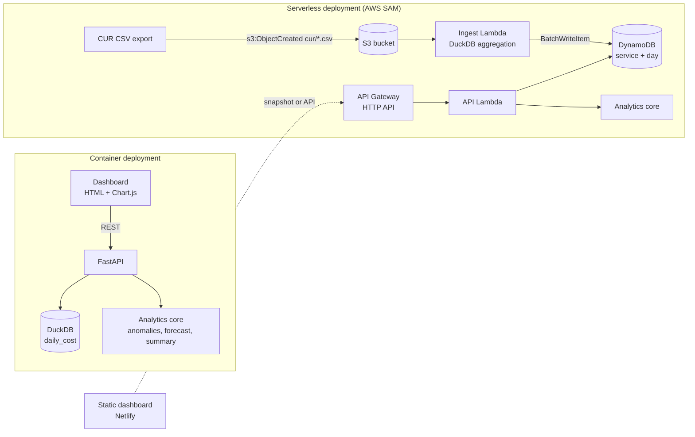

# CostLens

**Catch AWS cost spikes the day they happen and know your month-end bill before it arrives.**

[](https://github.com/Gonugunta-Venkata-Jayanth/CostLens/actions/workflows/ci.yml)
[](LICENSE)
[](https://www.python.org/)
[](https://fastapi.tiangolo.com/)
[](https://duckdb.org/)
[](infra/template.yaml)
[](https://jayanth-gonugunta-venkata.netlify.app/demos/costlens/)

---

## Overview

AWS Cost Explorer shows what was spent, but a runaway NAT gateway, an unbounded Lambda retry loop or a forgotten
GPU instance is usually noticed only when the invoice lands. CostLens ingests AWS Cost and Usage Report (CUR)
exports, aggregates them into daily spend per service with DuckDB, and runs two analyses on top:

- **Anomaly detection**: a rolling robust z-score (median and MAD) per service flags days whose cost is far
  above that service's recent baseline.
- **Month-end forecast**: a linear trend on the last 30 days projects the calendar-month total with a 95% interval.

The same analytics core runs in two deployment shapes: a single Docker container (FastAPI + DuckDB) for local or
self-hosted use, and a serverless stack on AWS (S3 → Lambda → DynamoDB → API Gateway) defined with AWS SAM and
sized for the AWS Free Tier.

## Key Features

- **CUR ingestion** via file upload, CLI or S3 event, with schema validation and idempotent re-ingestion
  (re-uploading a report replaces its service-days rather than double counting).
- **Robust anomaly detection** that is insensitive to the spikes it is looking for: flagged days are excluded from
  later baselines, and a minimum absolute excess filters out noise on low-cost services.
- **Spend forecast** with month-to-date, projected total, interval and daily trend.
- **Dashboard**: KPIs, stacked daily spend by service, forecast chart, spend share and an anomaly table with a
  live sensitivity control.
- **Two storage backends** behind one analytics API: DuckDB (local) and DynamoDB (AWS).
- **Measured detection quality**: an evaluation harness scores the detector against labelled synthetic spikes,
  and CI fails if F1 at the default threshold drops below 0.90.

## Architecture



| Path | Responsibility |
| --- | --- |
| `costlens/pipeline.py` | CUR validation, DuckDB aggregation, local `DuckDBStore` |
| `costlens/analytics.py` | Anomaly detection, forecast, summary, chart series |
| `costlens/synthetic.py` | Deterministic CUR generator with labelled injected spikes |
| `api/main.py` | FastAPI service and static dashboard hosting |
| `aws/handlers.py` | S3 ingest and HTTP API Lambda handlers, `DynamoStore` |
| `infra/template.yaml` | AWS SAM template: S3, DynamoDB, two Lambdas, HTTP API |
| `frontend/` | Dashboard (vanilla JS, Chart.js) |
| `scripts/` | Evaluation harness, demo build, Lambda packaging |

### Detection method

For each service and day *t* with at least 14 days of history, the baseline is the median of the previous
28 non-anomalous days and the spread is `1.4826 × MAD` (floored at 1% of the baseline). The day is flagged when

```
z = (cost_t − median) / spread  ≥  threshold   and   cost_t − median ≥ 1 USD
```

Severity is `high` when *z* is at least twice the threshold. The default threshold is 4.0, chosen from the
evaluation below.

## Tech Stack

| Layer | Technology |
| --- | --- |
| Frontend | HTML, CSS, vanilla JavaScript, Chart.js 4 |
| API | Python 3.12, FastAPI, Uvicorn |
| Data processing | DuckDB, NumPy |
| Storage | DuckDB file (local), Amazon DynamoDB (AWS) |
| Serverless | AWS Lambda (arm64), Amazon S3, API Gateway HTTP API, AWS SAM |
| Quality | pytest, pytest-cov, Ruff, cfn-lint |
| Delivery | Docker, GitHub Actions, Netlify (static demo) |

## Getting Started

### Prerequisites

- Python 3.11 or newer, or Docker

### Run with Docker

```bash
docker build -t costlens .
docker run --rm -p 8000:8000 costlens
# open http://localhost:8000
```

On first start the container seeds 120 days of synthetic CUR data so the dashboard is populated immediately.

### Run locally

```bash
python -m venv .venv && source .venv/bin/activate
pip install -r requirements-dev.txt
python -m costlens seed            # load synthetic data into data/costlens.duckdb
uvicorn api.main:app --reload      # http://localhost:8000
```

### Use your own billing data

Export a CUR 2.0 report as CSV (the required columns are `line_item_usage_start_date`,
`product_servicecode` and `line_item_unblended_cost`), then either upload it from the dashboard or run:

```bash
python -m costlens ingest path/to/cur.csv
python -m costlens report          # summary, forecast and anomalies as JSON
```

### API

| Method | Endpoint | Description |
| --- | --- | --- |
| GET | `/health` | Liveness and row count |
| GET | `/api/summary?period=30` | Totals, period-over-period change, spend share by service |
| GET | `/api/daily?service=AmazonEC2` | Daily cost series for charting |
| GET | `/api/anomalies?threshold=4&window=28&min_delta=1` | Detected anomalies |
| GET | `/api/forecast?lookback=30` | Month-end projection with interval |
| POST | `/api/ingest` | Multipart CSV upload (max 50 MB) |

Interactive documentation is served at `/docs`.

## Testing

```bash
make lint        # ruff
make test        # pytest with coverage
make eval        # detection precision/recall on synthetic data
make validate    # cfn-lint on the SAM template
```

The suite covers ingestion and schema validation, analytics edge cases (flat series, minimum history, exact
linear forecast), every API route including uploads, and both Lambda handlers against in-memory S3 and DynamoDB
fakes that simulate throttled batch writes and paginated scans.

CI (`.github/workflows/ci.yml`) runs lint, tests with an 85% coverage floor, template validation, the detection
quality gate, the demo and Lambda builds, then builds the Docker image and smoke-tests the running container.

## Deployment

### Static demo (Netlify)

`python scripts/build_demo.py` writes `dist/` with a `snapshot.json` produced by the same pipeline and analytics
code the API uses. The live demo is that build, served from Netlify:
<https://jayanth-gonugunta-venkata.netlify.app/demos/costlens/>. It runs on synthetic data only.

### AWS (Free Tier)

```bash
bash scripts/package_lambda.sh
sam build -t infra/template.yaml
sam deploy --guided                 # creates the stack; note the ApiUrl output
aws s3 cp cur.csv s3://<ReportBucketName>/cur/cur.csv
curl "<ApiUrl>/api/summary"
```

To point the dashboard at the deployed API, set `window.COSTLENS_CONFIG = { mode: "api", apiBase: "<ApiUrl>" }`
in `frontend/config.js` and pass the dashboard origin as the `AllowedOrigin` parameter.

Free Tier considerations: DynamoDB uses provisioned capacity of 5 RCU / 5 WCU, inside the always-free 25/25;
Lambda runs on arm64 with 512 MB; raw reports expire from S3 after 30 days; the HTTP API is throttled to
10 requests per second. Lambda, S3 and API Gateway usage beyond the Free Tier limits, or after the 12-month
Free Tier period for S3 and API Gateway, is billed at standard rates.

## Results / Metrics

All figures below are **measured on synthetic data** generated by `costlens/synthetic.py` and reproduced by
`python scripts/evaluate.py` (output in `reports/evaluation.json`). They describe behaviour on that generator,
not on real billing data.

Setup: 20 seeds × 120 days × 7 services, 10 injected spikes per seed (1.3× to 3.0× the expected cost),
76,800 line items in total, ±5% daily noise and a weekday/weekend pattern.

| Threshold (robust z) | Precision | Recall | F1 | False positives (of 16,800 service-days) |
| --- | --- | --- | --- | --- |
| 2.5 | 0.490 | 0.975 | 0.652 | 203 |
| 3.0 | 0.790 | 0.975 | 0.873 | 52 |
| 3.5 | 0.890 | 0.970 | 0.928 | 24 |
| **4.0 (default)** | **0.946** | **0.960** | **0.953** | **11** |
| 5.0 | 0.979 | 0.945 | 0.962 | 4 |

Ingesting one 3,840-line report took about 1.0 s on average in the build environment (DuckDB, including schema
inspection). Test coverage is 97% of statements.

## Roadmap

- Seasonality-aware baselines (day-of-week medians) to cut weekend false positives further.
- Per-account and per-tag breakdowns using CUR resource tags.
- Alert delivery to Slack or Amazon SNS when a high-severity anomaly is detected.
- Scheduled ingestion directly from the CUR S3 delivery bucket and Parquet support.
- Budget targets with burn-rate warnings on the forecast.

## License

Released under the [MIT License](LICENSE). Copyright (c) 2026 Jayanth Gonugunta Venkata.
